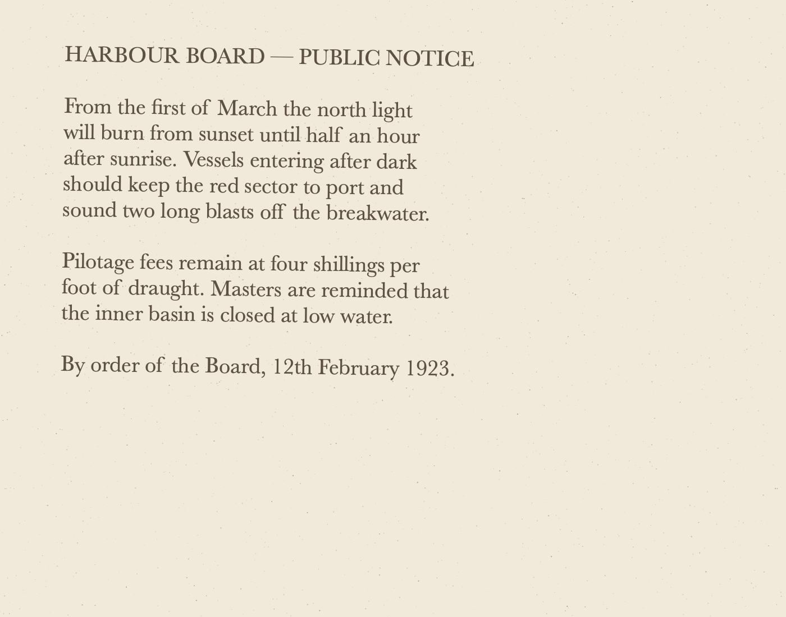

# vision-ocr

[](https://github.com/ajmc/vision-ocr/actions/workflows/ci.yml)


Fast, accurate OCR for images and PDFs from the command line, using the text recognizer built into macOS
(Apple's [Vision framework](https://developer.apple.com/documentation/vision/recognizing-text-in-images)).
No models to download, no Python, no cloud: one small binary.

## Demo



```console
$ vision-ocr examples/sample.png
HARBOUR BOARD - PUBLIC NOTICE

From the first of March the north light
will burn from sunset until half an hour
after sunrise. Vessels entering after dark
should keep the red sector to port and
sound two long blasts off the breakwater.

Pilotage fees remain at four shillings per
foot of draught. Masters are reminded that
the inner basin is closed at low water.

By order of the Board, 12th February 1923.
```

Need positions too? Ask for TSV or JSON:

```console
$ vision-ocr --format tsv examples/sample.pdf | head -3
file	page	x	y	width	height	confidence	text
examples/sample.pdf	1	0.1165	0.0945	0.5207	0.0189	1.000	HARBOUR BOARD — PUBLIC NOTICE
examples/sample.pdf	1	0.1163	0.1436	0.4574	0.0269	1.000	From the first of March the north light
```

**Why Vision rather than Tesseract?** On old or degraded scans (faded ink, yellowed paper, skew, speckle,
bleed-through) Vision's neural recognizer usually returns far cleaner text than Tesseract out of the box, with
no preprocessing, page-segmentation modes or trained data to tune, and it runs on the Apple Neural Engine.

## Install

Requires macOS 13 or later and Xcode 15+ (or the Command Line Tools) to build.

```bash
git clone https://github.com/ajmc/vision-ocr.git && cd vision-ocr
make install            # builds in release mode and installs to /usr/local/bin
```

Or build without installing:

```bash
swift build -c release
.build/release/vision-ocr --help
```

Install somewhere else with `make install PREFIX=~/.local`. A Homebrew formula is in
[`packaging/homebrew`](packaging/homebrew/vision-ocr.rb).

## Usage

```
vision-ocr [<inputs> ...] [--format text|tsv|json] [--language <code> ...] [--fast]
           [--no-language-correction] [--min-confidence <0-1>] [--dpi <dpi>]
           [--output-dir <dir>] [--recursive] [--list-languages] [--verbose]
```

Inputs can be images (PNG, JPEG, TIFF including multi-page, HEIC, GIF, BMP, WebP, JPEG 2000), PDFs, or folders
of them. Pages are recognized in parallel.

| Option | Meaning |
| --- | --- |
| `-f, --format` | `text` (default), `tsv` with bounding boxes and confidence, or `json` |
| `-l, --language` | Recognition language in priority order, e.g. `-l fr-FR -l en-US` or `-l fr-FR,en-US` |
| `--list-languages` | Print the languages your macOS version supports |
| `--fast` | Use Vision's fast recognizer (quicker, less accurate) |
| `--no-language-correction` | Turn off dictionary-based correction; better for codes, part numbers and non-words |
| `--min-confidence` | Drop lines below this confidence (0–1) |
| `--dpi` | Resolution for rendering PDF pages (default 300) |
| `-o, --output-dir` | Write one file per input there (`scan.pdf` → `scan.pdf.txt`) instead of printing to stdout |
| `-r, --recursive` | Include subfolders when an input is a folder |
| `-v, --verbose` | Report per-page progress on stderr |

### Examples

```bash
# OCR a scanned PDF to a text file
vision-ocr scan.pdf > scan.txt

# A folder of photos, one JSON file per photo
vision-ocr --format json --output-dir ocr/ ~/Pictures/receipts

# German text, keep only confident lines
vision-ocr -l de-DE --min-confidence 0.5 brief.jpg

# Serial numbers: don't let the language model "fix" them
vision-ocr --no-language-correction label.png

# Every line with its position, for further processing
vision-ocr -f tsv page.png | awk -F'\t' 'NR > 1 && $4 < 0.1'   # lines in the top 10% of the page
```

## Output formats

**text** prints lines in reading order (top to bottom, left to right). Lines on the same row are joined with two
spaces, a larger vertical gap becomes a blank line, and PDF pages are separated by a form feed (`\f`), like
`pdftotext`. With several inputs on stdout, each starts with a `==> path <==` header.

**tsv** has a header row and one row per line of text: `file`, `page` (1-based), `x`, `y`, `width`, `height`,
`confidence`, `text`. Coordinates are fractions of the page size with the origin at the **top-left**. Tabs,
newlines and backslashes in fields are escaped as `\t`, `\n` and `\\`.

**json** on stdout is an array with one object per input; with `--output-dir` each file holds one object:

```json
{
  "file" : "examples/sample.png",
  "pages" : [
    {
      "page" : 1,
      "width" : 1400,
      "height" : 1100,
      "lines" : [
        {
          "text" : "HARBOUR BOARD - PUBLIC NOTICE",
          "confidence" : 1,
          "box" : { "x" : 0.0797, "y" : 0.0718, "width" : 0.5252, "height" : 0.0412 }
        }
      ]
    }
  ]
}
```

(Keys are sorted alphabetically in the real output.)

## Using it as a library

The `VisionOCRKit` library target exposes the same pieces:

```swift
import VisionOCRKit

let file = InputFile(path: "scan.pdf")!
let doc = try file.recognize(options: RecognitionOptions(languages: ["en-US"]))
print(OutputFormat.text(doc))
```

## Limitations

- macOS only: Vision is an Apple framework.
- Multi-column layouts are read row by row across the columns. Use the TSV or JSON coordinates to split columns.
- Handwriting recognition is limited to what Vision supports on your macOS version.

## Development

```bash
swift test                          # unit tests plus end-to-end OCR of generated images and PDFs
swift Scripts/make-samples.swift    # regenerate examples/sample.png and examples/sample.pdf
```

The sample files are generated, not scanned, so they're free to redistribute.

## License

[MIT](LICENSE)
